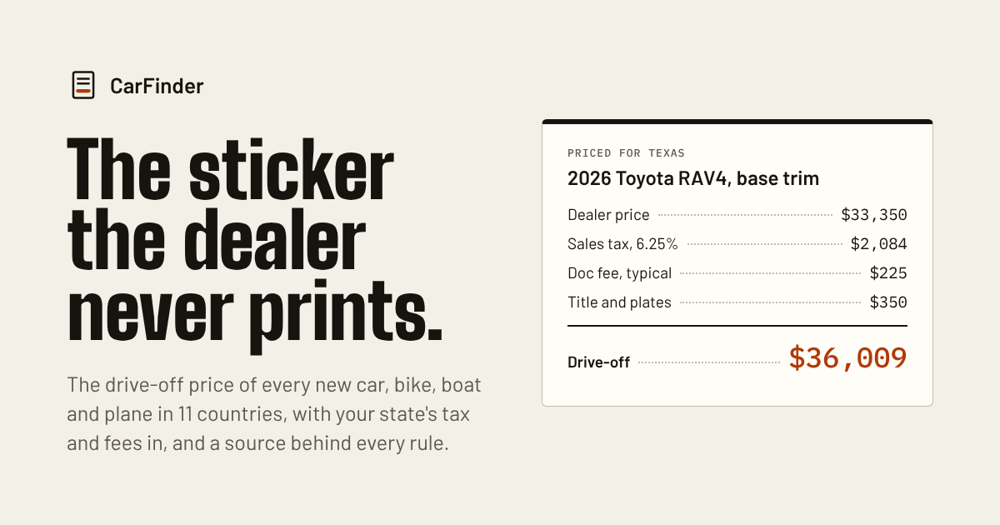
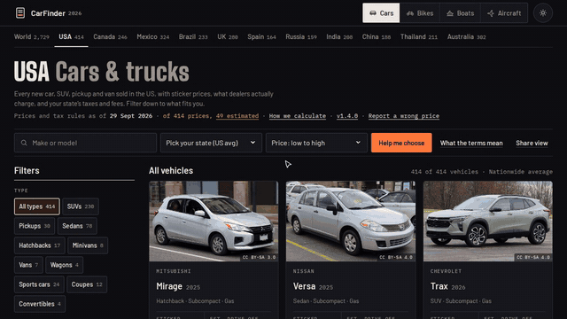
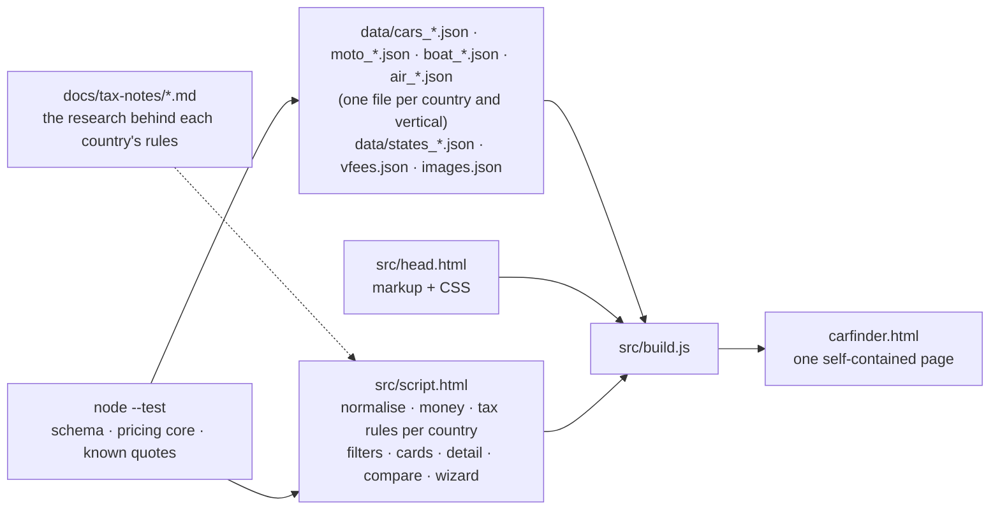

# CarFinder 2026

**Every new car, motorcycle, boat and aircraft on sale, and what it really costs.** The list price, what dealers
actually charge for that model right now, and the drive-off (ride-away, on-the-water, delivered) price for your state or
city once taxes and fees are added, for 2,729 cars and trucks, 1,444 motorcycles and scooters, 556 boats and jet skis
and 971 planes, business jets, helicopters and eVTOLs across the USA, India, China, the UK, Australia, Mexico, Spain,
Thailand, Russia, Brazil and Canada, most with a photo. It runs in your browser
(phones too), with no install, no account, no ads and no tracking.

**▶ [Website](https://destinjones.github.io/carfinder/) · [See it in action](https://destinjones.github.io/carfinder/#action) · [Open CarFinder](https://destinjones.github.io/carfinder/carfinder.html) · [Motorcycles](https://destinjones.github.io/carfinder/carfinder.html?v=moto) · [Boats](https://destinjones.github.io/carfinder/carfinder.html?v=boat) · [Aircraft](https://destinjones.github.io/carfinder/carfinder.html?v=air) · [About the creator](https://destinjones.github.io/carfinder/about.html)**

## What you can do
- **See three prices, not one.** Every card shows the maker's price from base to top trim, the band dealers really sell
  that model in this month (at sticker, a little under, or deep discounts), and the estimated total with tax, title and
  fees for the place you live.
- **Pick your state or city.** 50 US states, 20+ Indian states, 8 Chinese cities, Australian states, Mexican estados,
  Spanish regions, Russian regions, Brazilian states and Canadian provinces, each with its own sales tax, road tax,
  plates, insurance, levies and rebates. Everything recomputes when you change it. In California and New York you
  pick your city or county too (every one, from the states' own rate tables), and the breakdown names each state's
  real tax: Georgia's TAVT, North Carolina's highway use tax, South Carolina's capped fee, DC's excise by weight and mpg.
- **Know your state's trade-in rule.** Enter a trade-in and the tax is charged the way your state charges it: on the
  price less the trade-in in most states, on the full price in California, Virginia, Hawaii, Oregon and DC, with
  Michigan's $12,000 cap. Every state has a [sales-tax page](https://destinjones.github.io/carfinder/tax/) and a
  [trade-in page](https://destinjones.github.io/carfinder/trade-in-credit/) with a worked example and its sources.
- **Cars, motorcycles, boats or aircraft.** The switch at the top changes the whole page: scooters, nakeds, cruisers
  and adventure bikes with engine-size and transmission filters and a ride-away price (freight and setup, tax, plates,
  compulsory insurance, licence classes); jet skis, pontoons, center consoles, wake boats, RIBs and sailboats with
  length, capacity, propulsion and fuel-burn filters and an on-the-water price (freight and commissioning, the boat
  sales-tax caps, registration by length, trailer plates); trainers, piston singles and twins, turboprops, business
  jets, helicopters, gyroplanes, gliders and eVTOLs with seats, engine-type, range (nautical miles) and fuel-burn
  filters and a delivered price (factory list before tax, the sales tax, VAT or GST with the aircraft exemptions and
  caps, duty, registration, plus insurance, hangar and annual costs as information). Deep links:
  `carfinder.html?v=moto&cc=IN`, `?v=air&cc=UK`.
- **A photo of each.** 4,228 vehicles show their Wikipedia lead photo from Wikimedia Commons, credited to the
  photographer with its licence; the rest show a silhouette of their body type until a photo is found.
- **Filter like a buyer.** Body type, fuel, price range, size, brand tier, seats, drivetrain, minimum MPG, minimum
  electric range, brand, model year. Or answer four questions ("Help me choose") and let it set the filters for you.
- **Open a window sticker.** Drag the trim slider from base to fully loaded and watch every line of the cost breakdown
  move: destination, discount, tax, doc fee, registration, insurance, grants, with a note on what each is and whether
  it is negotiable. Plus the estimated monthly payment and yearly fuel or charging cost, with editable assumptions.
- **Compare four side by side.** Price, drive-off, monthly, efficiency, power, seats, drivetrain and market notes.
- **MPG and miles for everyone.** Every figure outside the US carries its US-unit twin (17.4 kmpl / 41 mpg, 543 km /
  337 mi, 53 mpg UK / 44 mpg US); aircraft fly in knots and nautical miles everywhere, with mph or km/h and miles or
  km alongside. The World tab lets you pick mpg, L/100 km or km/L outright.
- **A World tab.** All 2,729 cars (or 1,444 bikes, 556 boats or 971 aircraft) converted to one currency at the latest ECB
  rates, with a country filter, a cheapest-per-horsepower sort and a flag when a currency has moved since its price
  list was compiled.
- **Plain English.** Each country has a glossary (MSRP, OTR, ex-showroom, RTO, 落地价, tenencia, IPVA, ОСАГО…) and a
  "How these numbers work" note that says exactly what is estimated and how.
- **Every price shows its source.** The detail sheet links the maker's build-and-price page for that market (or its
  site), says what the dataset was compiled from (sources without a page are marked *not linked* rather than dressed up
  as citations), when it was compiled, which of four states the row is in (*checked*, *listed*, *converted* or
  *estimated*) and why, and which region's rules were applied, with the state revenue-department or
  transport-department page behind them in the US and India; the masthead shows the data-as-of date, the version and
  how many rows are converted or estimated. [How we calculate](https://destinjones.github.io/carfinder/methodology.html)
  publishes every tax table with a source column, the dealer bands, every exchange-rate table the data has used and
  the measured [data-quality scorecard](docs/DATA-QUALITY.md), all generated from the same data the app ships with.
- **Share any view.** The vertical, country, region, filters, sort, comparison set and open sheet live in the URL, so
  "Share view" or the share button on a sheet gives a link that opens exactly what you see. Filters and typing rewrite
  the address; opening a sheet adds a history entry, so Back closes it and Forward reopens it.
- **Wrong price? Tell us.** Every sheet opens a prefilled GitHub issue with the vehicle, region, figures, source and
  link, or copies the same details to the clipboard for an e-mail or a message (no account needed).
- **Installable and offline.** Add it to a home screen; the page and fonts are cached, and a deploy shows up on the
  next online visit.

## How it's built

- **One file, no framework.** Markup, CSS and plain JavaScript with the data inlined, so the page works from a
  `file://` URL and keeps working offline once loaded. The only build step is a 60-line Node script that stitches the
  parts together. Fonts are self-hosted (SIL OFL); the page makes no third-party requests.
- **Data as JSON, rules as functions.** Each country's cars, bikes, boats and aircraft are JSON files with a
  documented row schema ([docs/DATA.md](docs/DATA.md)). Each country's car taxes and fees are one function (`bdUS`,
  `bdIN`, `bdCN`…) that returns the breakdown lines; motorcycle, boat and aircraft fees are rows in `data/vfees.json`
  read by one table-driven engine, so a wrong rate is a one-line fix.
- **Photos by reference.** `data/images.json` maps each vehicle to its Wikipedia article's lead image on Wikimedia
  Commons with the author and licence; the page links to the 960 px rendition and never copies the files.
- **Phone-first.** One sticky row (search, sort, filters), bottom-sheet filters and dialogs, 44 px controls, 16 px
  inputs, light and dark themes, tested from 360 px up.

## Accuracy
Dealer prices are **bands by demand level**, not quotes: at or above sticker for waiting-list models, a few percent off
for most, 10–35% off where a model is being cleared (the band and the reason are on every card). Taxes and fees follow
the published rules on the compile date, **29 September 2026**. Motorcycle and boat prices were compiled on
**10 October 2026**; outside the US most are *estimated* until a published price list is found. Aircraft
prices were compiled on **12 October 2026** from manufacturer price lists and the trade press; outside the US they are
the maker's dollar or euro list converted at the ECB rates of that day and shown before VAT, GST and duty (the
breakdown adds them), so every one of them is *converted*. The World tab converts at the ECB rates of **14 October
2026** (rubles at the Bank of Russia rate) and says how far a currency has moved since the row's list was compiled.
Across all 5,700 rows, 2,517 are *listed* (the maker's published price on the compile date), 865 are *converted*
(a published list in another currency at a dated rate) and 2,318 are *estimated*; none is *checked* by a person yet.
The exact figures per dataset, with per-vertical floors that CI holds, are in the measured
[data-quality scorecard](docs/DATA-QUALITY.md) and its [history](docs/data-quality-history.csv). The tests assert known real-world quotes (a RAV4 in Texas, a Creta in Maharashtra, a
RAV4 in Ontario, a Sandero in the UK, a Seagull in China, a Grom in Texas, a Splendor in Delhi, a Spark in Florida, an SR22 in Texas and Oregon, a Challenger in the UK, an R44 in India) and
run the pricing engines for all 97,000 vehicle-and-region combinations. Treat every number as a
range to bargain within and get the out-the-door price in writing from two or three dealers. The full method, every
table and every source are on [How we calculate](https://destinjones.github.io/carfinder/methodology.html); the
provenance of each row (source, compile date, state and why) is in its detail sheet.

## Run it
- **Online:** use the links above.
- **Locally:** clone, then `python3 -m http.server` (or any static server) and open http://localhost:8000/. Opening
  `carfinder.html` straight from disk works too.
- **After editing `src/`, `data/` or `docs/tax-notes/`:** `node src/build.js` rebuilds `carfinder.html`,
  `methodology.html`, `sw.js`, `docs/DATA-QUALITY.md` and `docs/data-quality-history.csv`; commit them all (CI checks they are current).
- **Tests:** `node --test` (schema checks, pricing core, known quotes, build in sync). Browser checks (every tab and
  control at phone and desktop widths) need Python with Playwright: `pip install playwright pillow && playwright
  install chromium`, then `python3 test/browser/audit.py` and `python3 test/browser/interact.py`.
- **For a claude.ai artifact:** `node src/build.js --artifact` writes `dist/carfinder-artifact.html`, a bare fragment
  that uses Google Fonts (the artifact wrapper supplies the document skeleton).

| Path | What |
|---|---|
| `carfinder.html` | the app, built; `methodology.html` (how we calculate), `sw.js` and `docs/DATA-QUALITY.md` are built too; `index.html` and `about.html` are the website |
| `src/` | `head.html` (markup + CSS), `script.html` (all code), `build.js`, `methodology.js` + `methodology.html` (the generated methodology page), `quality.js` (the scorecard), `sw.js` (service worker template) |
| `data/` | `cars_<cc>.json`, `moto_<cc>.json`, `boat_<cc>.json`, `air_<cc>.json` per country, `states_us.json` and `states_in.json` (with a citation per row), `vfees.json` (bike, boat and aircraft fee rules), `images.json` (photo index), `sources.json` (compile dates, dated exchange-rate tables, price sources, makers' sites and build-and-price pages), `quality-floor.json` (the scorecard's floors) |
| `tools/` | `air.py` (regenerates the aircraft rows from the dollar master list at the recorded rates), `fx.mjs` (pulls an ECB and Bank of Russia rate table for a compile date) |
| `docs/` | [data schema](docs/DATA.md), [architecture](docs/ARCHITECTURE.md), [testing](docs/TESTING.md), [data quality](docs/DATA-QUALITY.md) and its [history](docs/data-quality-history.csv) (both generated), [tax research notes](docs/tax-notes/) per country, for US bikes and boats, and for aircraft |
| `test/` | Node tests (`*.test.mjs`) and the Playwright browser checks (`browser/`) |
| `brand/` | emblem, screenshots, social card, fonts, the portrait, the demo video and GIFs (`video/`), and `tools/` to regenerate them (`shots.py`, `record.py`) |

## Contributing
Found a wrong price, a missing model or an out-of-date tax rule? Open an issue with a source, or edit the JSON row (the
schema is in [docs/DATA.md](docs/DATA.md)), run `node src/build.js && node --test`, and send a pull request. New
countries are welcome too: see [CONTRIBUTING.md](CONTRIBUTING.md) for the adapter pattern (a config block, a money
formatter, a region table and one breakdown function).

## Credit and licence
CarFinder is by [Destin Jones](https://destinjones.github.io/carfinder/about.html) ([GitHub](https://github.com/destinjones)),
vibe coded in public with Claude as the building partner. Also by me:
[Open Overwatch](https://destinjones.github.io/open-overwatch/), a live map of the whole planet, and
[Ironbound](https://destinjones.github.io/godot-open-rts/), a free open source RTS made with Godot.

The code and data are MIT licensed ([LICENSE](LICENSE)): use it, fork it, build on it, and keep the copyright line.
Vehicle prices and specifications belong to their manufacturers and are compiled here for reference. The fonts are
under the SIL Open Font License ([brand/fonts/](brand/fonts/)). Vehicle photos are not part of this repository: the
page links to each vehicle's Wikipedia lead image on Wikimedia Commons under the licence shown with it (mostly
CC BY-SA), credited to its photographer on the card and the detail sheet.
If you write about it or build on it, please credit it: *Jones, D. (2026). CarFinder 2026 [Computer software].
https://github.com/destinjones/carfinder* (GitHub's "Cite this repository" button reads [CITATION.cff](CITATION.cff)).
